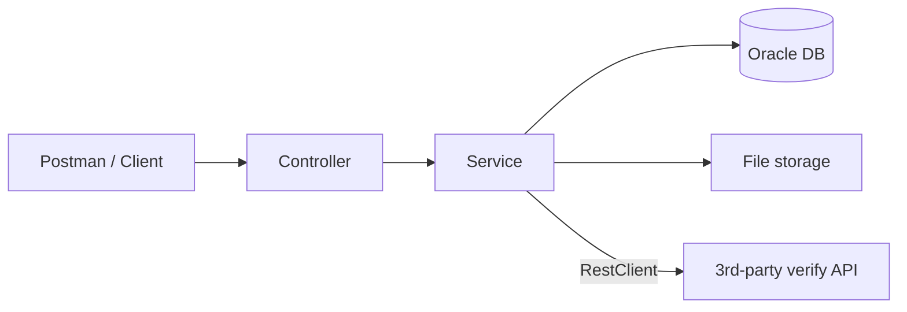

# Customer Document Management & Verification System

Spring Boot REST API for a bank to register customers, upload their identity documents, let an officer approve or reject them, and verify them through a 3rd-party provider.

   

## Features

- Customer registration and lookup (by ID or IC number)
- Document upload (multipart, max 5 MB) with files stored on disk and metadata in Oracle
- Paginated document list, 10 records per page, optional filter by status and customer
- Officer approve/reject flow with a full audit trail (status history)
- Nested call to a 3rd-party verification API (a built-in mock is included)
- Consistent response envelope and global error handling
- `@Transactional` on writes, `@Transactional(readOnly = true)` on reads

## Architecture



Layers: `controller` -> `service` -> `repository` (Spring Data JPA), with `dto`, `mapper`, `entity`, `enums`, `client`, `config` and `exception` packages.

## Tech stack

| Area | Choice |
|---|---|
| Language / framework | Java 17, Spring Boot 4.1.2 |
| Persistence | Spring Data JPA, Hibernate, Oracle |
| Validation | Jakarta Bean Validation |
| 3rd-party call | Spring `RestClient` with timeout |
| Build | Maven |
| Tests | JUnit 5, Mockito, MockMvc |

## API summary

Base URL: `http://localhost:8080`

| # | Method | Endpoint | Description |
|:-:|---|---|---|
| 1 | `POST` | `/api/customers` | Register customer |
| 2 | `GET` | `/api/customers/{customerId}` | Get customer by ID |
| 3 | `POST` | `/api/customers/search` | Search customer by IC number |
| 4 | `POST` | `/api/documents` | Upload document (multipart) |
| 5 | `GET` | `/api/documents/{documentId}` | Get document details |
| 6 | `GET` | `/api/documents/{documentId}/content` | Download the uploaded file |
| 7 | `GET` | `/api/documents?page=1&status=&customerId=` | List documents, 10 per page |
| 8 | `PATCH` | `/api/documents/{documentId}/status` | Approve or reject (PENDING only) |
| 9 | `GET` | `/api/documents/{documentId}/history` | Status change history |
| 10 | `POST` | `/api/documents/{documentId}/verifications` | Verify via 3rd-party API (nested call) |
| - | `POST` | `/mock/third-party/verify` | Mock 3rd-party provider |

### Example

```powershell
curl.exe -X POST http://localhost:8080/api/customers `
  -H "Content-Type: application/json" `
  -d '{\"fullName\":\"Siti Aminah\",\"idNo\":\"950505055555\",\"emailAddress\":\"siti@example.com\"}'
```

Every response uses the same envelope:

```json
{
  "status": 200,
  "path": "/api/documents/29/verifications",
  "data": { "documentId": 29, "result": "VERIFIED", "verifiedDate": "..." }
}
```

## Getting started

### Prerequisites

- JDK 17
- Maven 3.9+
- Oracle database reachable from your machine (VPN if remote)

### 1. Create the database objects

Run the scripts in `document-management/document-management/database/` in order:

1. `01_create_user.sql`
2. `02_create_tables.sql`
3. `03_seed_data.sql`
4. `04_seed_pagination_data.sql` (optional, extra rows to try pagination)
5. `05_migrate_ic_no_dash.sql` (only for databases created before IC numbers dropped dashes)

Hibernate runs with `ddl-auto: validate`, so it never changes the schema.

### 2. Configure environment variables

| Variable | Default | Purpose |
|---|---|---|
| `DB_HOST` | `localhost` | Oracle host |
| `DB_PORT` | `1521` | Oracle port |
| `DB_SID` | `XE` | Oracle SID |
| `DB_USER` | - | DB user (required) |
| `DB_PASSWORD` | - | DB password (required) |
| `UPLOAD_DIR` | `uploads` | Folder for uploaded files |
| `VERIFICATION_BASE_URL` | `http://localhost:8080/mock/third-party` | 3rd-party provider base URL |

```powershell
$env:DB_HOST = "your-host"
$env:DB_SID = "your-sid"
$env:DB_USER = "TESTDB"
$env:DB_PASSWORD = "your-password"
```

### 3. Run

```powershell
cd document-management\document-management
mvn spring-boot:run
```

The app starts on port 8080.

## Testing

```powershell
mvn test
```

Unit tests cover the services and controllers (JUnit 5, Mockito, MockMvc).

### Try the 3rd-party verification (API 10)

1. Upload a document with `POST /api/documents`, note the returned `documentId`.
2. `POST /api/documents/{documentId}/verifications` (no body).
3. The service reads the document, calls `POST /mock/third-party/verify`, and returns `VERIFIED` or `UNABLE_TO_VERIFY`.

The mock marks a file as unverifiable when its name contains `fake` or `invalid`. Verification does not change the officer approval status and nothing is saved by this call.

## Design decisions

| Decision | Reason |
|---|---|
| `@Transactional` on writes, `readOnly = true` on reads | Matches the assessment requirement; read-only lets JPA skip dirty checking |
| Pessimistic lock when changing status | Two officers cannot approve and reject the same document at once |
| Only `PENDING` documents can change status | Prevents invalid transitions |
| Verification method is not transactional | Does not hold a DB connection while waiting for the 3rd-party API |
| File deleted if the DB transaction rolls back | Avoids orphan files |
| Fixed page size of 10, 1-based page number | Assessment requirement |
| Schema owned by SQL scripts, not Hibernate | Predictable, reviewable database changes |
| Mock provider behind a configurable base URL | Swap to the real provider with one env var |

## Project structure

```
document-management/
  document-management/
    database/            SQL scripts (user, tables, seed data)
    src/main/java/com/bank/document_management/
      controller/        REST endpoints (+ mock 3rd-party)
      service/           business logic and transactions
      repository/        Spring Data JPA
      client/            3rd-party API client
      entity/ dto/ mapper/ enums/ config/ exception/ util/
    src/main/resources/application.yml
    src/test/java/       unit tests
  postman/               Postman collection
```

## Roadmap

- [ ] Postman collection in `postman/`
- [ ] Request/response logging to a log file
- [ ] Persist verification results (new table and `GET /verifications`)
- [ ] Authentication and role-based access (officer vs customer)
- [ ] Integration tests with Testcontainers


